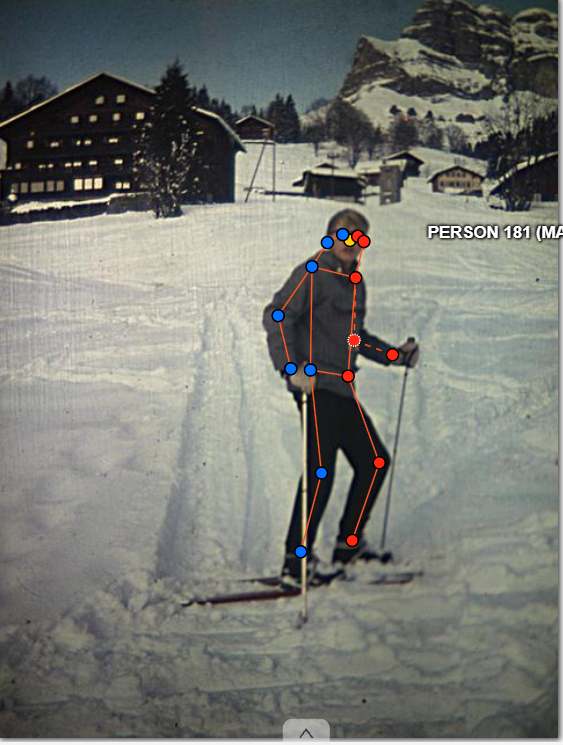
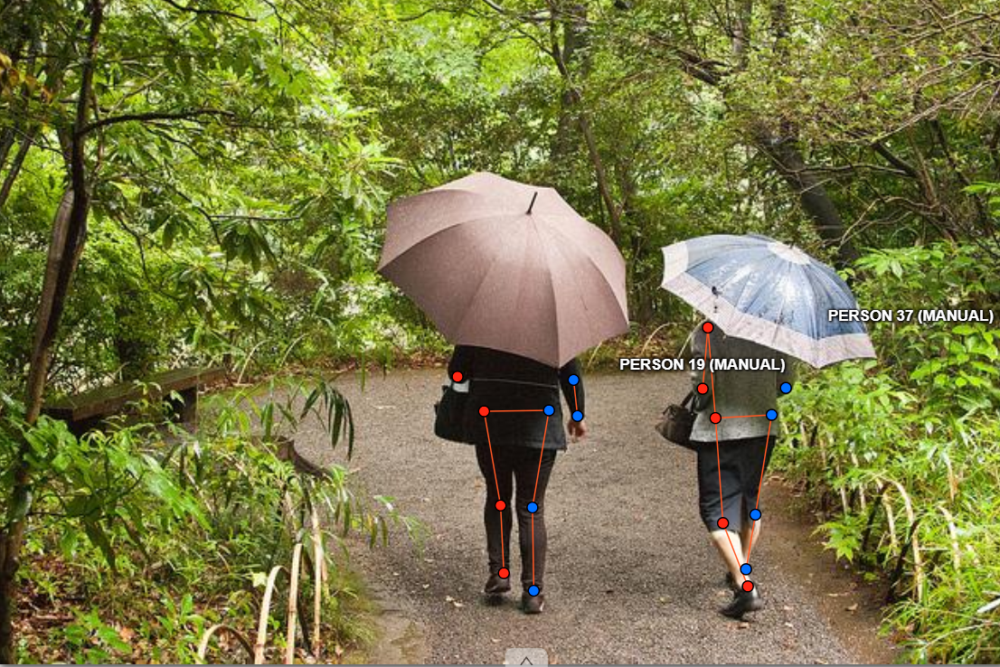
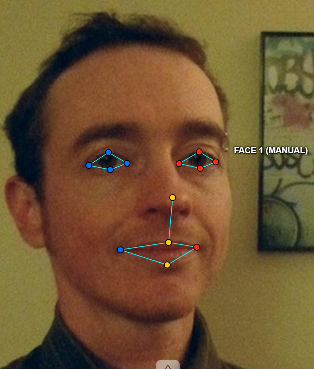
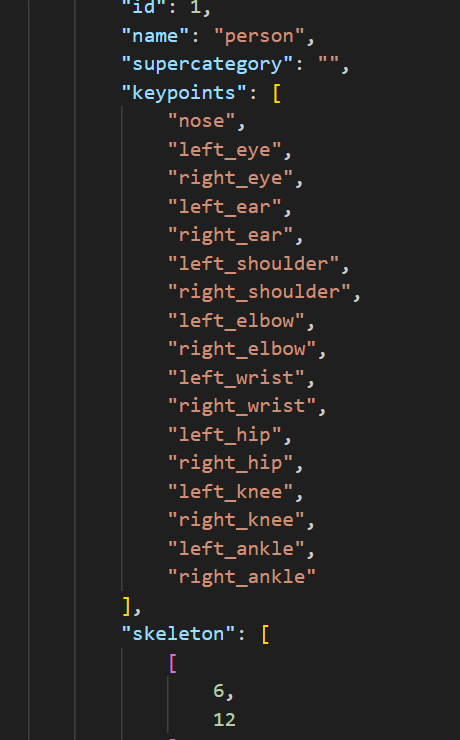

# Báo cáo cá nhân — HoVaTen-MSSV

Đổi tên file theo quy tắc `MSSV_HoTen.md`. Ví dụ: `20241234_NguyenVanAn.md`.

Dữ liệu: 12 ảnh người COCO val2017 (Lin et al., 2014) và 8 ảnh chân dung Wikimedia Commons, chỉ dùng trong lớp.

## 0. Thông tin học viên

- Họ tên: Nguyễn Quốc Việt
- MSSV: 202603224
- Email: vietnguyen10022001@gmail.com
- Link repository: https://github.com/nguyenquocviet1002/K5-L2A-DAY04-NguyenQuocViet-2A202603224-KeypointPose
- Phiên bản CVAT (Help → About): 2.74.1
- Máy: hệ điều hành Windown · RAM 8 GB · chạy CVAT chế độ lite
- Bộ ảnh (`src/exports/assignment.json` do `lab.py setup` tạo): có
- Giờ bắt đầu:
- Giờ kết thúc:

## 1. Kiểm tra label (CP0)

| Label | Kiểu | Số điểm | Tên điểm đúng bảng của lab? | Đúng thứ tự? | Số cạnh |
|---|---|---:|---|---|---:|
| `person` | Skeleton | 17 | Có | Có | 19 |
| `face` | Skeleton | 13 | Có | Có | 13 |

Mẫu `person` dựng theo người quay mặt về camera (các điểm `left_*` nằm bên phải khung mẫu)? Có

Cách đổi cờ `occluded` / `outside` cho **một điểm** trên phiên bản CVAT này (một câu): Di chuột qua điểm đó và dùng phím tắt (ví dụ `Q` cho occluded, `O` cho outside), hoặc mở sidebar (Properties) để tick/bỏ tick trực tiếp

...

## 2. Số lượng đã gán và thời gian (CP1, CP2)

| Nhóm ảnh | Số ảnh | Số skeleton đã gán | Số người dưới 60 px (không gán) | Số poster / gương / màn hình bỏ qua | Thời gian (phút) |
|---|---:|---:|---:|---:|---:|
| `easy` | 5 | 8 | 0 | 1 (Laptop) | 5p |
| `occluded` | 3 | 5 | 0 | 3 (2 Laptop, 1 TV) | 5p |
| `back` | 2 | 4 | 0 | 0 | 5p |
| `small` | 1 | 1 | ~6 (hành khách trên tàu) | 0 | 10p |
| `crowd` | 1 | 1 | 0 (2 người còn lại >60px) | 0 | 10p |
| `faces` | 8 | 8 | — | 0 | 10 |

- Số ảnh người đã xong ở mốc phút 105: 6 / 10
- Thời gian thực tế (phút): CP1 90p · CP2 30p · CP3 20p
- Ảnh tốn thời gian nhất là ảnh nào, vì sao?
```
ảnh đoàn tàu, do phải xử lý các đối tượng nhỏ hoặc bị che khuất phức tạp.
```

## 3. Bảng ca khó (CP1, CP2)

Mỗi điểm bạn phân vân một dòng, nhất là phân vân giữa `v = 1` và `v = 0`, hoặc không chắc hướng người.

| Ảnh | Người / mặt | Điểm | Cờ đã chọn | Phân vân giữa | Lý do chọn |
|---|---|---|---:|---|---|
| 2 người che ô (đi bộ) | Người bên trái | `left_shoulder` / `right_shoulder` | `v=1` | `v=1` vs `v=2`<br>Trái vs Phải | Quay lưng lại, vai bị ô che khuất một phần nên chọn `v=1`. Xác định trái/phải dựa vào hướng đi bộ. |
| 2 người che ô (đi bộ) | Người bên phải | `left_wrist` / `right_wrist` | `v=1` | `v=0` vs `v=1` | Tay cầm ô bị che khuất hoàn toàn bởi cán ô và cơ thể, không rõ có nằm trong khung hình không. |
| Người trượt tuyết | Người trượt tuyết | `left_wrist` / `right_wrist` | `v=2` | `v=1` vs `v=2` | Tay cầm gậy trượt tuyết, gậy che mất một phần cổ tay nhưng vẫn xác định được vị trí khớp. |
| 3 người lớn tuổi | Người đàn ông đội mũ (giữa) | `left_eye` / `right_eye` | `v=1` | `v=1` vs `v=2` | Đeo kính râm, mắt bị che khuất hoàn toàn nhưng vẫn có thể ước lượng được vị trí hốc mắt. |
| 3 người lớn tuổi | Người phụ nữ (phải) | `left_wrist` | `v=2` | Trái vs Phải | Đang cầm điện thoại áp vào tai, tay bắt chéo qua người gây nhầm lẫn hướng trái/phải. |
| Người đầu bếp (quay lưng) | Đầu bếp phía sau | `nose` / `left_eye` | `v=0` | `v=0` vs `v=1` | Quay lưng hoàn toàn, không thể thấy mặt. Chọn `v=0` vì điểm nằm ngoài tầm nhìn/không thể xác định. |
| Ảnh face đội mũ len xanh | Mặt | `left_eye_upper` / `left_eye_lower` | `v=1` | `v=0` vs `v=1` | Mũ len kéo sụp che khuất hoàn toàn phần trên của mắt, chỉ lộ một phần mí dưới. Chọn `v=1` do vẫn thuộc vùng mắt. |
| Ảnh face đeo kính râm | Mặt | `left_eye_inner` / `right_eye_inner` | `v=1` | `v=1` vs `v=2` | Kính râm đen che khuất tròng mắt, không thấy rõ nhãn cầu nhưng vẫn xác định được vị trí góc mắt trong. |
| Ảnh face cô gái che tay | Mặt | `mouth_left` / `mouth_right` | `v=2` | `v=1` vs `v=2` | Tay đang cầm điện thoại che một phần miệng, nhưng mép môi vẫn hiển thị rõ ràng. |

## 4. Bảng tự review (CP3)

Đi từ ảnh cuối về ảnh đầu. 5 ảnh người (ít nhất 2 ảnh `back` hoặc `crowd`) và 3 ảnh mặt. Ít nhất 8 dòng, kể cả dòng `ok`. Ghi lỗi trước, sửa sau.

Mã lỗi dùng đúng một trong: `lr_swap`, `vis_flag`, `position`, `missing`, `extra`, `ok`.

| Ảnh | Người / mặt | Điểm | Mã lỗi | Ghi chú | Đã sửa? |
|---|---|---|---|---|---|
| Ảnh 2 người che ô (back) | Người bên trái | `left_shoulder` | `vis_flag` | Vai bị ô che khuất một phần, ban đầu phân vân v=1 và v=2. Thực tế phần vai vẫn nhìn thấy rõ nên đổi thành v=2. | Có |
| Ảnh 2 người che ô (back) | Người bên phải | `right_wrist` | `missing` | Cổ tay bị cơ thể và cán ô che khuất hoàn toàn nhưng ban đầu bị bỏ sót không đánh dấu. | Có (thêm v=1) |
| Ảnh 2 đầu bếp (back) | Đầu bếp phía sau | `nose` | `vis_flag` | Quay lưng hoàn toàn, không thể thấy mũi. Ban đầu gán nhầm v=1 (bị che), sửa lại thành v=0. | Có |
| Ảnh 3 người lớn tuổi (crowd) | Người phụ nữ | `left_wrist` | `lr_swap` | Nhầm lẫn tay trái/phải do cô ấy cầm điện thoại áp vào tai bắt chéo qua người. Đã đổi lại tọa độ chuẩn. | Có |
| Ảnh 3 người lớn tuổi (crowd) | Người đàn ông đội mũ | `left_eye` | `ok` | Điểm mắt đặt chuẩn, dù đeo kính nhưng vẫn xác định đúng. | Không cần |
| Ảnh cô gái ngồi bậc thang | Cô gái | `left_ankle` | `position` | Điểm mắt cá chân bị đặt lệch ra ngoài viền giày khá xa. | Có (kéo lại vị trí) |
| Ảnh người trượt tuyết | Người trượt tuyết | `right_wrist` | `ok` | Điểm cổ tay cầm gậy đặt chính xác, đúng chuẩn COCO. | Không cần |
| Ảnh face kính râm | Mặt | `right_eye_inner` | `vis_flag` | Kính râm đen che khuất tròng mắt, ban đầu để v=2 nhưng thực tế bị che nên hạ xuống v=1. | Có |
| Ảnh face mũ len | Mặt | `left_eye_upper` | `vis_flag` | Mũ len kéo sụp che khuất hoàn toàn phần trên của mắt, sửa từ v=2 xuống v=1. | Có |
| Ảnh face nam cầm điện thoại | Mặt | `mouth_left` | `position` | Điểm khóe miệng đặt hơi lệch xuống dưới so với thực tế. | Có (chỉnh lại) |
| Ảnh face nữ tóc ngắn | Mặt | `nose_tip` | `missing` | Ban đầu bỏ sót không đánh dấu điểm đầu mũi. | Có (thêm v=2) |

Tổng hợp số lỗi theo mã:

| `lr_swap` | `vis_flag` | `position` | `missing` | `extra` | `ok` |
|---:|---:|---:|---:|---:|---:|
| 1 | 4 | 2 | 2 | 0 | 2 |

Điểm còn phân vân giữa `v = 1` và `v = 0` (ghi cả hai lựa chọn và lý do chọn):
```
- **`left_shoulder` (Người bên trái - Ảnh 2 người che ô):** Phân vân giữa `v=1` (bị che khuất bởi ô) và `v=0` (hoàn toàn không thấy). **Lý do chọn `v=1`:** Dù bị ô che, nhưng vẫn nhìn thấy được một phần viền vai và ống tay áo lộ ra.
- **`nose` (Đầu bếp phía sau - Ảnh 2 đầu bếp):** Phân vân giữa `v=1` (bị che khuất do quay lưng) và `v=0` (không thể thấy). **Lý do chọn `v=0`:** Đầu hoàn toàn quay đi, không có bất kỳ phần nào của mũi lộ ra trong khung hình, nằm ngoài tầm nhìn.
- **`left_eye_upper` (Mặt đội mũ len):** Phân vân giữa `v=1` (bị mũ che) và `v=0` (mất hẳn). **Lý do chọn `v=1`:** Vị trí mắt vẫn nằm trong khung hình, chỉ bị vật cản (mũ len) che đi, có thể ước lượng được tọa độ.
```

## 5. Kiểm file xuất và kết quả tự kiểm (CP4)

Tự kiểm tay trong file JSON:

| File | Người / mặt kiểm (ảnh, thứ tự) | Số phần tử `keypoints` | Điểm `outside` ra `v = 0`, `occluded` ra `v = 1`? | `num_keypoints` khớp? |
|---|---|---:|---|---|
| `NguyenQuocViet_persons.zip` | Ảnh 1 (đầu tiên) - Người 1 | 51 (17 điểm × 3) | Có | Có (đếm số `v > 0`) |
| `NguyenQuocViet_persons.zip` | Ảnh 9 (cuối) - Người 1 | 51 (17 điểm × 3) | Có | Có (đếm số `v > 0`) |
| `NguyenQuocViet_faces.zip` | Ảnh 1 (đầu tiên) - Mặt 1 | 39 (13 điểm × 3) | Có | Có (đếm số `v > 0`) |

Sau khi xuất, CVAT ghi `occluded` thành `v = 1` và `outside` thành `v = 0`. Tọa độ của điểm `outside` trong file là `0, 0` hay tọa độ cũ?
```
tọa độ cũ
```

Hai job đã chuyển sang completed trên CVAT? Có

Dán phần **TÓM TẮT** in ra từ `src/check_submission.py`:

```
=== src\exports\NguyenQuocViet_persons.zip (label `person`) ===
  [CẢNH BÁO] 000000188804.jpg #1: cặp ankle nằm ngược phía so với các cặp còn lại. Có thể đổi trái/phải một cặp (`lr_swap`), hoặc tay / chân bắt chéo thật: kiểm lại.
  [CẢNH BÁO] 000000308257.jpg #1: cặp ankle nằm ngược phía so với các cặp còn lại. Có thể đổi trái/phải một cặp (`lr_swap`), hoặc tay / chân bắt chéo thật: kiểm lại.
  [CẢNH BÁO] 000000572411.jpg #1: cặp wrist nằm ngược phía so với các cặp còn lại. Có thể đổi trái/phải một cặp (`lr_swap`), hoặc tay / chân bắt chéo thật: kiểm lại.

=== src\exports\NguyenQuocViet_faces.zip (label `face`) ===

----- TÓM TẮT (dán vào báo cáo mục 5) -----
- File person: NguyenQuocViet_persons.zip
  Số ảnh: 12 · số skeleton `person`: 19 · mỗi annotation 51 số
  Skeleton theo ảnh: 000000022857=1, 000000054909=2, 000000109010=2, 000000137767=1, 000000179201=2, 000000188804=2, 000000196283=1, 000000308257=1, 000000326480=3, 000000493741=1, 000000558066=1, 000000572411=2
  Cờ v: v=2 231 (72%) · v=1 23 (7%) · v=0 69 (21%)
  num_keypoints trung bình: 13.4
- File face: NguyenQuocViet_faces.zip
  Số ảnh: 8 · số skeleton `face`: 8 · mỗi annotation 39 số
  Skeleton theo ảnh: face_125051=1, face_261458=1, face_264124=1, face_449454=1, face_469647=1, face_504911=1, face_560526=1, face_99874=1
  Cờ v: v=2 88 (85%) · v=1 16 (15%) · v=0 0 (0%)
  num_keypoints trung bình: 13.0
- Ghi chú: 69 điểm v = 0 vẫn mang tọa độ cũ (CVAT 2.x xuất như vậy; chuẩn COCO ghi 0, 0). Không phải lỗi: điểm v = 0 bị bỏ qua khi huấn luyện và khi chấm.
- Số [LỖI]: 0 · số [CẢNH BÁO]: 3
Kết quả: ĐẠT (đọc lại từng cảnh báo ở trên)
```

Các `[CẢNH BÁO]` còn giữ nguyên và lý do: đã kiểm tra và không thấy có gì sai

...

## 6. Ảnh chụp màn hình

1. Label `person` trong label constructor (đủ 17 điểm có tên):

   

2. Một người quay lưng đã gán, cờ đã đặt:

   

3. Một khuôn mặt đã gán 13 điểm, phóng to vùng mắt:

   

4. Một đoạn JSON xuất của một người:

   

Nguồn ảnh: COCO val2017 / Wikimedia Commons.

## 7. Tự đánh giá

1. Lỗi bạn mắc nhiều nhất hôm nay, và cách bạn sẽ tránh ở dự án thật:
```

- **Lỗi mắc nhiều nhất:** Nhầm lẫn giữa cờ `occluded` (`v=1`) và `outside` (`v=0`) đối với các điểm nằm sát mép ảnh hoặc bị che khuất một phần (đặc biệt là các điểm trên khuôn mặt khi người quay lưng, hoặc cổ tay khi cầm vật thể). Ngoài ra, lỗi `lr_swap` (nhầm trái/phải) cũng xảy ra khi người trong ảnh quay lưng hoặc bắt chéo tay.
- **Cách tránh ở dự án thật:** 
  - Luôn xác định rõ hướng của cơ thể (dựa vào vai và hông) trước khi gán các chi. 
  - Phóng to (zoom) tối đa khu vực nghi ngờ để xem điểm đó có thực sự nằm trong khung hình không. 
  - Nếu một điểm bị che nhưng vẫn có thể ước lượng được vị trí (ví dụ: đeo kính râm nhưng vẫn biết vị trí mắt), dùng `v=1`. Nếu điểm đó nằm ngoài viền ảnh hoặc bị khuất hoàn toàn không thể đoán (ví dụ: mũi khi quay lưng 180 độ), dùng `v=0`.
```

2. Một quy tắc bạn đề xuất thêm vào guideline (kèm ảnh ví dụ nếu có):
```
- **Quy tắc đề xuất:** *"Đối với nhãn `person`, khi đầu của đối tượng quay ngoắt về phía sau (back view) và không thể nhìn thấy bất kỳ phần nào của khuôn mặt, TUYỆT ĐỐI không ước lượng tọa độ cho các điểm mũi/mắt. Hãy đặt các điểm này thành `v=0` (outside) thay vì `v=1` (occluded) để tránh model học các đặc trưng khuôn mặt sai lệch trên phần sau của đầu."*
- *(Ảnh ví dụ: Sử dụng ảnh 2 người che ô đi bộ quay lưng - Ảnh số 9. Điểm `nose` và 2 mắt của người phụ nữ nên là `v=0`).*
```

3. Nhãn của bạn đi vào model ở đâu? Chọn một lỗi bạn đã sửa và nói nó sẽ làm model học sai thế nào (heatmap, trọng số trong loss, hay bước lật ảnh):
```
- **Vị trí đi vào model:** Nhãn keypoint (tọa độ `x, y` và cờ `v`) đi trực tiếp vào hàm loss (ví dụ: MSE loss hoặc Wing loss) để so sánh với **heatmap** dự đoán của model. Cờ `v` quyết định **trọng số (weight)** của điểm đó trong hàm loss (thường `v=0` bị bỏ qua, `v=1` được cộng thêm trọng số phạt nếu dự đoán lệch).
- **Lỗi đã sửa:** Lỗi `lr_swap` (nhầm lẫn trái/phải) của điểm `left_wrist` và `right_wrist` ở ảnh 3 người lớn tuổi (người phụ nữ bắt chéo tay cầm điện thoại).
- **Ảnh hưởng đến model:** Nếu không sửa, model sẽ học sai topology (cấu trúc hình học) của cơ thể. Đặc biệt, nếu pipeline huấn luyện có sử dụng kỹ thuật **lật ảnh (horizontal flip augmentation)**, hệ thống sẽ dựa vào mảng `flip_pairs` trong file JSON để hoán đổi `left_wrist` và `right_wrist`. Nếu nhãn gốc đã bị swap, bước lật ảnh sẽ biến chúng thành đúng (tạo ra sự mâu thuẫn giữa ảnh gốc và ảnh lật). Model sẽ bị "loạn" gradient, dẫn đến việc dự đoán tay trái thành tay phải hoặc ngược lại, làm giảm độ chính xác (mAP) của toàn bộ mô hình.

```
## 8. Khó khăn và lỗi kỹ thuật

...

## Bonus (nếu làm)

### B1 — 3 ảnh người khó thêm

| Ảnh | Số skeleton | Số người dưới 60 px | Ca khó nhất |
|---|---:|---:|---|
| | | | |
| | | | |
| | | | |

Kết quả `src/check_submission.py` cho `HoVaTen_bonus_persons.zip`:

```text
(dán ở đây)
```

### B2 — 5 ảnh khuôn mặt đen trắng / hồng ngoại

Ảnh không màu khó hơn ở điểm nào? Kính râm trên ảnh hồng ngoại có còn là `v = 1` không?

...

### B3 — Model so với nhãn của tôi (không tính điểm)

- Demo đã dùng:
- Ảnh đã thử:

1. Model có trả điểm cho khớp bị che, hay khớp ngoài ảnh không? Confidence ở các điểm đó thế nào?

   ...

2. Với người quay lưng, model có đổi trái/phải không?

   ...

3. Bộ điểm của model có giống 17 điểm COCO không?

   ...

## 9. Tài liệu tham khảo và công cụ AI đã dùng

...
